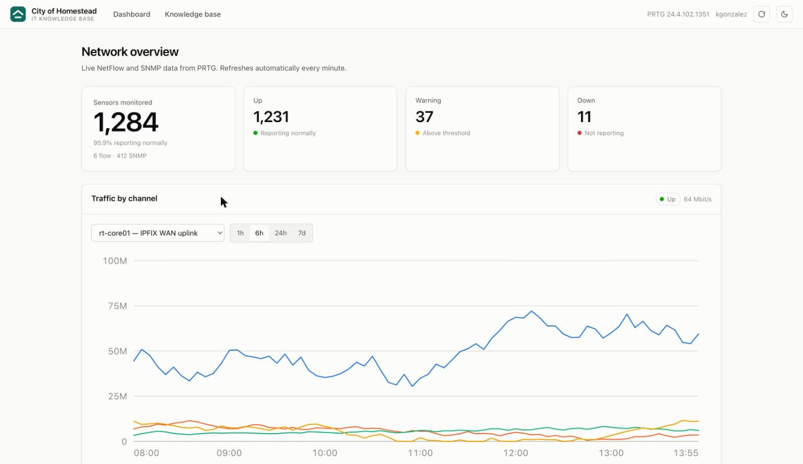
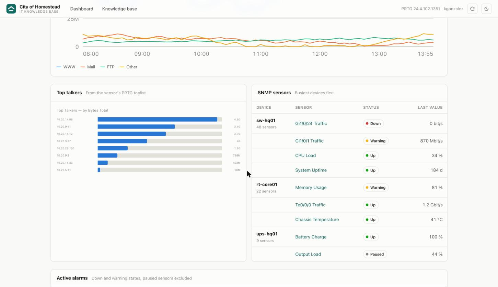
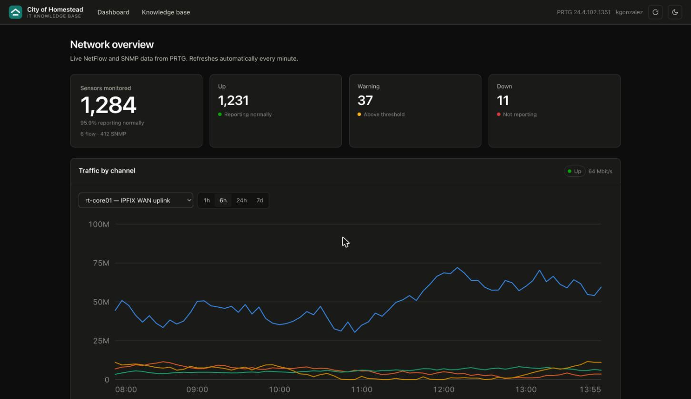
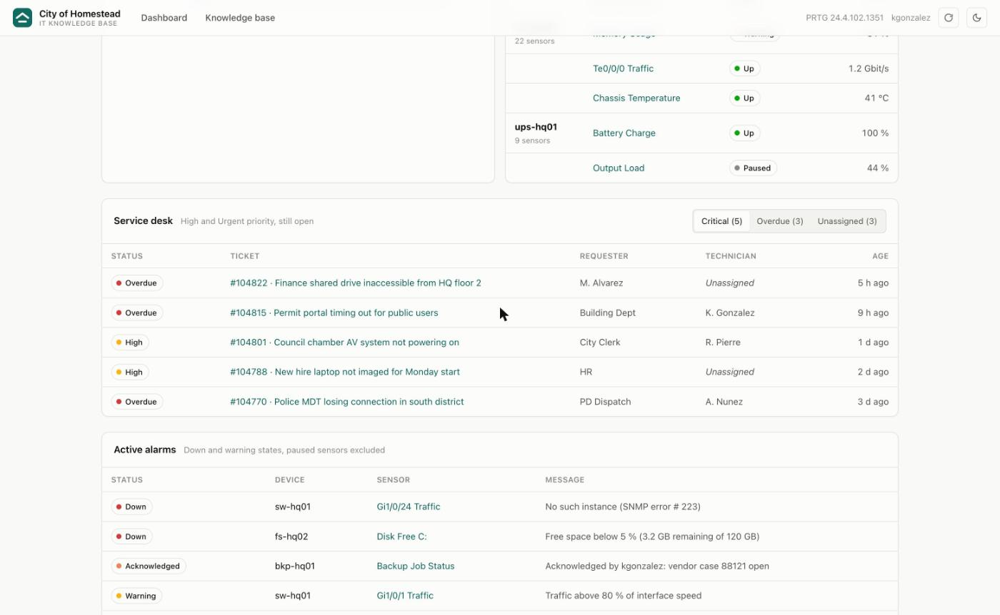
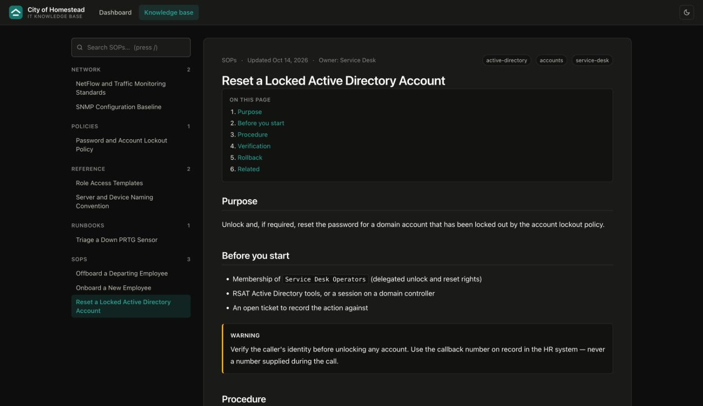
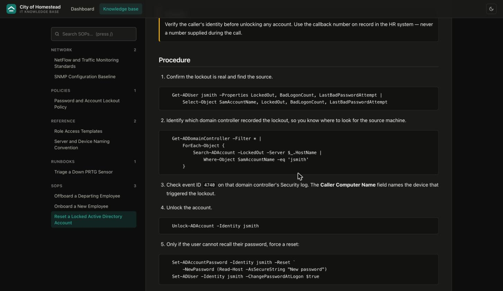
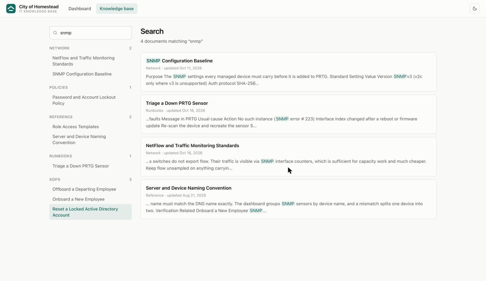

# City of Homestead — IT Knowledge Base

An internal web app that gives the IT team one place to answer two questions:
**"is the network healthy right now?"** and **"how do I do this correctly?"**

The front page is a live PRTG dashboard — NetFlow traffic, SNMP sensor health
and active alarms — plus an optional panel of open ServiceDesk Plus tickets.
Behind it sits a searchable library of SOPs, runbooks, policies and reference
material written in Markdown.

Runs on **Windows Server 2019 / IIS** with **Windows Authentication**, so staff
are signed in by their domain account with no login page to maintain.

---

## What it does

### The dashboard answers "what is happening on the network?"

Instead of logging into PRTG and navigating its tree, a technician opens one
page and sees the whole estate at a glance:

- **Sensor health at a glance** — how many sensors are up, warning or down, with
  the monitored total as the headline figure
- **Traffic by channel** for any NetFlow / IPFIX / sFlow / jFlow sensor, over
  1 hour to 7 days, with a hover crosshair giving exact values per channel
- **Top talkers** — which hosts are consuming the link right now, read from the
  sensor's PRTG toplist. This is the panel you want during a "the internet is
  slow" call
- **SNMP sensors grouped by device**, worst-affected device first
- **Active alarms**, ordered by severity, with paused sensors excluded so
  planned maintenance doesn't read as an outage

It refreshes every minute and stops polling when the tab is in the background.



Top talkers and SNMP health sit below the traffic chart:



The whole interface follows the operating system's light or dark setting, and
each person can override it with the toggle in the top right:



### The service desk panel answers "what is the team on the hook for?"

Optional. When ServiceDesk Plus is configured, a panel pulls open tickets
straight from SDP so a technician doesn't have to keep a second tab open:

- **Critical** — High and Urgent priority, still open
- **Overdue** — past their SLA due-by time, whatever the priority
- **Unassigned** — nobody has picked them up yet

Each button carries its own count, so the shape of the queue is visible before
you click. Ticket numbers link straight into SDP.



Overdue outranks priority in the status colour, deliberately: a breached SLA is
a harder fact than a priority somebody typed in at submission.

The panel **hides itself entirely** when SDP isn't configured, so this stays a
pure PRTG dashboard until you want otherwise.

### The knowledge base answers "how do I do this correctly?"

Procedures live as Markdown files in a folder — no database, no CMS, no WYSIWYG
editor to fight. Anyone comfortable with a text editor can write one, and the
whole library is diffable and reviewable in Git.

- **Organised by category** in a sidebar — SOPs, runbooks, network, policies,
  reference
- **Full-text search** across titles, headings, tags and body text, with the
  matching terms highlighted
- **Automatic table of contents**, so a long procedure stays navigable
- **Callouts** for warnings and cautions, syntax-highlighted code blocks,
  tables, task lists and cross-links between documents
- **Deep-linkable headings** — send a colleague the exact step, not the document
- **Prints cleanly**, for the procedures that have to exist on paper



Numbered steps with the commands to run, so a procedure can be followed exactly
rather than approximately:



Search ranks title matches above heading matches above body matches, so typing
a procedure's name finds it immediately:



### Why both in one place

An alarm on the dashboard and the runbook that explains it are two clicks apart.
`Triage a Down PRTG Sensor` is written to be read while looking at the very
dashboard that is showing red.

---

## Why there is a backend

PRTG's API authenticates with an API token or a `passhash` in the query string.
A browser calling PRTG directly would need that credential in client-side
JavaScript, where anyone who can open the page can read it — and it would hit
CORS restrictions anyway.

So a thin ASP.NET Core app sits in front: it holds the credential server-side
and exposes only a handful of read-only, purpose-built endpoints. There is
deliberately **no generic passthrough**, so the stored credential can't be used
to reach arbitrary PRTG endpoints from the browser.

Everything else is static files — no database, no build step for the frontend,
no npm, no CDN. The markdown renderer and charts are hand-written and
dependency-free, so the site works on an air-gapped network.

---

## Layout

```
it-knowledge-base/
├── src/KnowledgeBase/
│   ├── Program.cs                 host, security headers, static files, auth
│   ├── Endpoints/ApiEndpoints.cs  /api/me, /api/prtg/* and /api/sdp/*
│   ├── Prtg/
│   │   ├── PrtgClient.cs          typed PRTG API client, 15s response cache
│   │   └── PrtgModels.cs          options + DTOs, PRTG status-code mapping
│   ├── Sdp/
│   │   ├── SdpClient.cs           ServiceDesk Plus client, OAuth token cache
│   │   └── SdpModels.cs           options + DTOs, ticket severity mapping
│   ├── appsettings.json           defaults (tracked — no secrets here)
│   ├── appsettings.Production.example.json   template for the live token
│   ├── web.config                 IIS: Windows Auth, .md MIME type, compression
│   └── wwwroot/
│       ├── index.html             dashboard
│       ├── docs.html              knowledge base
│       ├── assets/css/app.css     design tokens + all styling
│       ├── assets/brand/          logo, favicons (see Branding below)
│       ├── assets/js/
│       │   ├── core.js            theme, API helper, formatting, status pills
│       │   ├── markdown.js        markdown → HTML, no dependencies
│       │   ├── charts.js          inline-SVG line/bar/sparkline charts
│       │   ├── dashboard.js       PRTG front page
│       │   └── docs.js            tree, search, article rendering, routing
│       └── content/               ← your documents live here
│           ├── index.json         generated search index
│           ├── _template.md       starting point for a new document
│           ├── sops/ runbooks/ network/ policies/ reference/
├── docs/images/                   screenshots used in this README
└── tools/
    ├── Build-DocsIndex.ps1        regenerate content/index.json
    ├── Build-Icons.py             regenerate favicon.ico/PNGs (only on rebrand)
    └── Publish-Site.ps1           build + deploy to IIS
```

---

## Quick start

### On the server

See **[DEPLOYMENT.md](DEPLOYMENT.md)** for the full walkthrough — IIS features,
app pool, Windows Auth, HTTPS, PRTG credentials and a troubleshooting table.

Short version:

1. `Install-WindowsFeature Web-Server, Web-Windows-Auth, …`
2. Install the **.NET 8 Windows Hosting Bundle** (after IIS)
3. Create the site and app pool, enable Windows Auth, disable Anonymous
4. `.\tools\Publish-Site.ps1`
5. Copy `appsettings.Production.example.json` → `appsettings.Production.json`
   on the server and fill in `BaseUrl` and `ApiToken`
   (see [Keeping the live token out of Git](#keeping-the-live-token-out-of-git))

### Locally, to try it out

```bash
cd src/KnowledgeBase
dotnet run
```

Then open <http://localhost:5000>. Local runs use
`appsettings.Development.json`, which disables the authentication requirement
(Kestrel has no Windows Auth handler) and accepts self-signed PRTG
certificates. The knowledge base works with no PRTG at all — the dashboard just
shows a banner saying PRTG is unavailable.

---

## Writing documents

Create a `.md` file under `wwwroot/content/<category>/`, starting with front
matter:

```markdown
---
title: Reset a Locked Active Directory Account
category: SOPs
tags: [active-directory, accounts]
updated: 2026-10-14
owner: Service Desk
---

## Purpose

...
```

| Field | Required | Notes |
|-------|----------|-------|
| `title` | recommended | Falls back to the first `# heading`, then the filename |
| `category` | recommended | Groups the sidebar; falls back to the folder name |
| `tags` | no | Weighted in search |
| `updated` | no | Falls back to the file's modified date |
| `owner` | no | Shown in the article header |

Then rebuild the index:

```powershell
.\tools\Build-DocsIndex.ps1

# or, while writing:
.\tools\Build-DocsIndex.ps1 -Watch
```

Files beginning with `_` are skipped, so `_template.md` stays out of the
knowledge base.

### Supported markdown

Headings (with anchor links), **bold**, *italic*, `inline code`, fenced code
blocks with a language tag, nested ordered and unordered lists, task lists,
tables with alignment, blockquotes, horizontal rules, images, and links.

Cross-link documents by slug — the path under `content/` without the extension:

```markdown
See [the SNMP baseline](#/network/snmp-baseline).
```

GitHub-style callouts render as coloured panels:

```markdown
> [!WARNING]
> Verify identity before unlocking any account.
```

`NOTE`, `TIP`, `IMPORTANT`, `WARNING` and `CAUTION` are supported.

---

## API

All endpoints are read-only, require an authenticated user, and return JSON.

| Endpoint | Returns |
|----------|---------|
| `GET /api/me` | The signed-in Windows user |
| `GET /api/prtg/health` | Whether PRTG is configured and reachable |
| `GET /api/prtg/summary` | Sensor counts by state, PRTG version |
| `GET /api/prtg/alarms?limit=25` | Sensors in a non-OK state, worst first |
| `GET /api/prtg/netflow` | Flow sensors (NetFlow, IPFIX, sFlow, jFlow) |
| `GET /api/prtg/snmp?limit=12` | SNMP sensors grouped by device |
| `GET /api/prtg/sensors/{id}/history?hours=6&avg=300` | Channel history |
| `GET /api/prtg/sensors/{id}/toplists` | Toplists on a flow sensor |
| `GET /api/prtg/sensors/{id}/toplists/{toplistId}` | Toplist rows |
| `GET /api/sdp/health` | Whether ServiceDesk Plus is configured |
| `GET /api/sdp/summary` | Open/critical/overdue/unassigned ticket counts |
| `GET /api/sdp/tickets?filter=critical\|overdue\|unassigned&limit=10` | Matching tickets, worst first |

PRTG failures come back as RFC 7807 problem documents — `503` when PRTG isn't
configured, `502` when it rejects the credential or is unreachable, `504` on
timeout — so the dashboard can show the reason inline instead of going blank.

Responses are cached for `Prtg:CacheSeconds` (default 15) so a room full of open
dashboards doesn't hammer the PRTG core.

---

## Configuration

Every key below can live in `appsettings.json` (defaults, tracked in Git) or
`appsettings.Production.json` (per-server, gitignored — put the token there):

| Key | Default | Purpose |
|-----|---------|---------|
| `Prtg:BaseUrl` | — | PRTG core URL, e.g. `https://prtg.contoso.local` |
| `Prtg:ApiToken` | — | Read-only API token (preferred) |
| `Prtg:Username` / `Prtg:PassHash` | — | Used only when no token is set |
| `Prtg:AllowUntrustedCertificate` | `false` | Accept PRTG's self-signed certificate |
| `Prtg:CacheSeconds` | `15` | Response cache lifetime |
| `Prtg:MaxSensors` | `2000` | Row cap on the sensor table query |
| `Prtg:TimeoutSeconds` | `20` | PRTG request timeout |
| `Security:RequireAuthenticatedUser` | `true` | Set `false` only for local dev |

### Keeping the live token out of Git

`appsettings.json` is tracked, so the real PRTG token must never go in it.
Use `appsettings.Production.json` instead — it is gitignored, and ASP.NET Core
layers it on top of `appsettings.json` automatically because `web.config` sets
`ASPNETCORE_ENVIRONMENT=Production`.

On the web server, once:

```powershell
cd C:\inetpub\KnowledgeBase
Copy-Item appsettings.Production.example.json appsettings.Production.json
notepad appsettings.Production.json      # fill in BaseUrl and ApiToken
Restart-WebAppPool -Name 'KnowledgeBase'
```

Only the keys that differ need to be present:

```json
{
  "Prtg": {
    "BaseUrl": "https://prtg.homestead.local",
    "ApiToken": "your-read-only-token",
    "AllowUntrustedCertificate": true
  }
}
```

`Publish-Site.ps1` mirrors with robocopy `/MIR`, which deletes anything at the
destination that isn't in the publish output — so it explicitly excludes
`appsettings.Production.json` and `appsettings.Local.json`. Your token survives
a redeploy.

If you'd rather keep the token out of files entirely, set it as an app pool
environment variable:

```powershell
Set-ItemProperty 'IIS:\AppPools\KnowledgeBase' -Name processModel.environmentVariables `
    -Value @{ 'Prtg__ApiToken' = 'your-read-only-token' }
```

The double underscore is the .NET section separator — `Prtg__ApiToken` maps to
`Prtg:ApiToken`. Precedence, later winning:

```
appsettings.json  <  appsettings.Production.json  <  environment variables
```

Use a **read-only** PRTG account or API key either way. The dashboard never
writes to PRTG.

---

## Security notes

- PRTG credentials stay server-side; the browser only sees `/api/prtg/*` results.
- The PRTG base URL *is* sent to the browser, so the UI can deep-link sensors.
  It carries no credential.
- Error messages never echo the PRTG request URL, because the passhash variant
  carries the credential in the query string.
- Markdown is escaped before rendering, and link targets are scheme-checked —
  `javascript:`, `vbscript:` and non-image `data:` URLs are neutralised.
- A strict Content-Security-Policy is sent; the site loads no third-party code,
  so nothing needs an exception.
- `X-Content-Type-Options`, `X-Frame-Options`, `Referrer-Policy` and HSTS
  (outside Development) are set in `Program.cs`.

Documents are visible to every authenticated user. If some SOPs need to be
restricted, put them in a separate IIS application with its own ACL — the
single `index.json` is not an authorisation boundary.

---

## Branding

> **The mark is an original design, not the City's official seal.** It was
> drawn for this tool because no official asset was supplied. If the City has
> brand standards, replace the files below — nothing else needs to change.

A gable over a ground line: a homestead on its land. Two elements only, so it
still resolves at 16px in a browser tab.

| File | Used for |
|------|----------|
| `assets/brand/favicon.svg` | Primary favicon; switches tile colour with the OS theme |
| `assets/brand/favicon.ico` | Fallback (16/32/48) for browsers without SVG favicon support |
| `assets/brand/apple-touch-icon.png` | iOS/iPadOS home-screen bookmark (full-bleed; iOS applies its own mask) |
| `assets/brand/logo-mark.svg` | Mark on its own, theme-aware, for `` use |
| `assets/brand/logo-light.svg` | Full lockup for light backgrounds — documents, email, print |
| `assets/brand/logo-dark.svg` | Same lockup, dark-background step |

The site's topbar **inlines** the mark rather than linking an image, so the
tile can read the theme tokens and recolour instantly on toggle.

### Colours

Brand hue is a two-step teal — a light step and a dark step chosen for their
own surface, not an automatic flip:

| Token | Light | Dark | Checked |
|-------|-------|------|---------|
| `--brand` (tile) | `#116b63` | `#14786e` | white glyph 6.35:1 / 5.33:1 |
| `--brand-ink` (text, links) | `#0f5f58` | `#2bab9b` | 7.31:1 / 6.14:1 on page |

**Brand colour is deliberately separate from the chart palette.** `--brand*`
drives chrome only — logo, nav, links, focus rings, search highlights. Charts
keep `--series-1…8` and the status colours, which are a validated,
colourblind-checked set. Rebranding therefore cannot break chart legibility.

### Rebranding

1. Edit the four SVGs in `assets/brand/` (and the inline `<svg class="brand__mark">`
   block in `index.html`, `docs.html` and `error.html` — same paths).
2. Update `--brand`, `--brand-ink` and `--brand-wash` in `assets/css/app.css`,
   in all three places: `:root`, the `prefers-color-scheme: dark` block, and
   the `[data-theme="dark"]` block.
3. Update `STROKES_FULL` and `TILE_LIGHT` in `tools/Build-Icons.py` to match,
   then run `python3 tools/Build-Icons.py` to regenerate the raster fallbacks.
4. Change the `.brand__name` / `.brand__sub` text in the three HTML pages.

If you drop in an official logo as a finished image instead, replace the inline
`<svg class="brand__mark">` with an `` and skip steps 1 and 3.

## Design

Colours, chart marks and status roles follow a validated palette: categorical
hues assigned in fixed order and never cycled, one y-axis per chart, status
always paired with a written label rather than carried by colour alone, and
dark mode stepped for the dark surface rather than flipped. Both themes are
defined as CSS custom properties in `assets/css/app.css` — change them there
and the whole site, charts included, follows.
